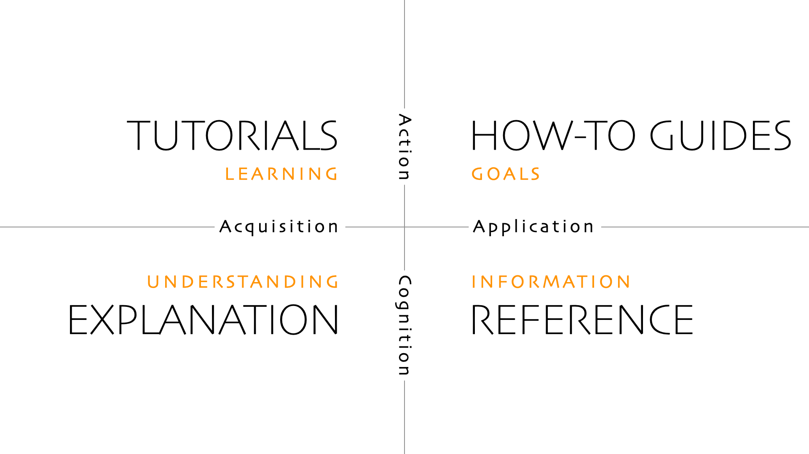

Wir schreiben die Doku nach [Diátaxis](https://diataxis.fr). Jede Seite gehört genau in
eine von vier Schubladen.

## Wie wir die Schubladen nutzen

### Anleitungen (How-to)

Schritt für Schritt zu einem Ziel, für Leute, die schon wissen, was sie wollen:
- Firmware flashen, iOS-App installieren
- Backend und Web-Viewer lokal starten, Relay starten
- In die LeoCloud deployen, Tests ausführen
- Diese Doku lokal bauen, einen OpenSpec-Change anlegen

### Referenz

Nachschlagen, knapp und vollständig:
- WebSocket-Befehle, Telemetrie-Format, MSP
- Hardware und Verdrahtung, Ports und URLs
- Konfiguration des Liftoff-Hover, Spec-Status

### Erklärung

Hintergrund und Entscheidungen:
- Architektur (C4), warum Phase 2
- Kommunikation, Flugmodi und Sicherheit
- iOS-App, Hover-Regler, Standalone-Firmware, CI/CD, Deployment

### Tutorials

Für Einsteiger:innen gibt es die [Anleitung](../../guide). Sie führt Pilot:innen durch die
App und den Liftoff-Hover.

## Was nicht in die Doku gehört

- **Anforderungen** stehen in OpenSpec (`openspec/specs/`); die Doku verlinkt dorthin.
- **Sitzungen, Reviews, Berichte** stehen im [Projekt](../../project).
