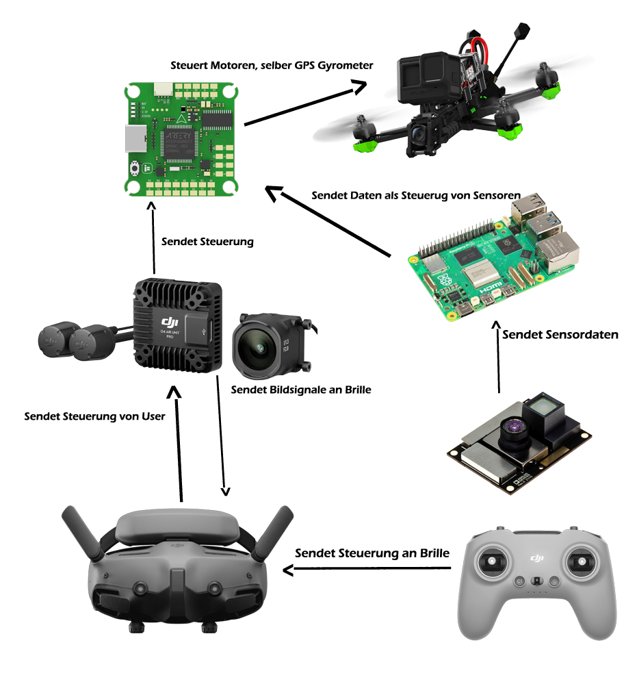

EasyPilot besteht aus Teilen, die über zwei Phasen entstanden sind:
- **Phase 1:** eine echte Drohne mit Companion-Computer und iOS-App.
- **Phase 2:** Simulation, weil die Drohne nicht mehr fliegt (siehe [Phase 2](../phase-2)).

## Systemkontext



## Container



## Teilsysteme

| Teil | Ordner | Phase | Stand |
|---|---|---|---|
| Companion-Firmware | `PlatformIO/Projects/EasyPilotIOS` | 1 | fertig |
| Standalone-Web-Firmware | `PlatformIO/Projects/easypilot` | 1 | fertig |
| iOS-App | `EasyPilotIOS` | 1 | fertig, ein bekannter Bug (RC-Modus) |
| Relay, MSP-Sender | `webinterface/backend/src/main/python` | 1 | fertig, ohne Tests |
| Backend | `webinterface/backend` | 1/2 | nur `/api/status` |
| Web-Viewer → Web-Simulator | `webinterface/frontend` | 2 | Viewer fertig, Simulator offen |
| Liftoff-Hover | `simulator/liftoff-hover` | 2 | fertig, getestet |

Den genauen Stand pro Anforderung zeigt die [Spec-Übersicht](../../reference/openspec).

## Warum ein Companion-Computer?

Der Flight Controller (Betaflight) stabilisiert die Drohne bereits sehr gut. Statt ihn zu
ersetzen, hängt ein ESP32-C3 per UART daran:
- Er **liest** über MSP Lage und Akku.
- Er **schreibt** Motorwerte für eigene Testmodi.
- Er bringt **WLAN** mit, und damit die Verbindung zur App.

Das hält den eigenen Code klein und den sicherheitskritischen Teil bei Betaflight.

## Ursprüngliches Konzept (überholt)

So war EasyPilot zu Projektstart geplant: mit Raspberry Pi, Abstandssensor und Steuerung über
DJI-Brille und -Fernbedienung. Der Raspberry Pi wurde durch den ESP32 ersetzt. Brille und
Fernbedienung fallen seit dem Air-Unit-Defekt weg.

