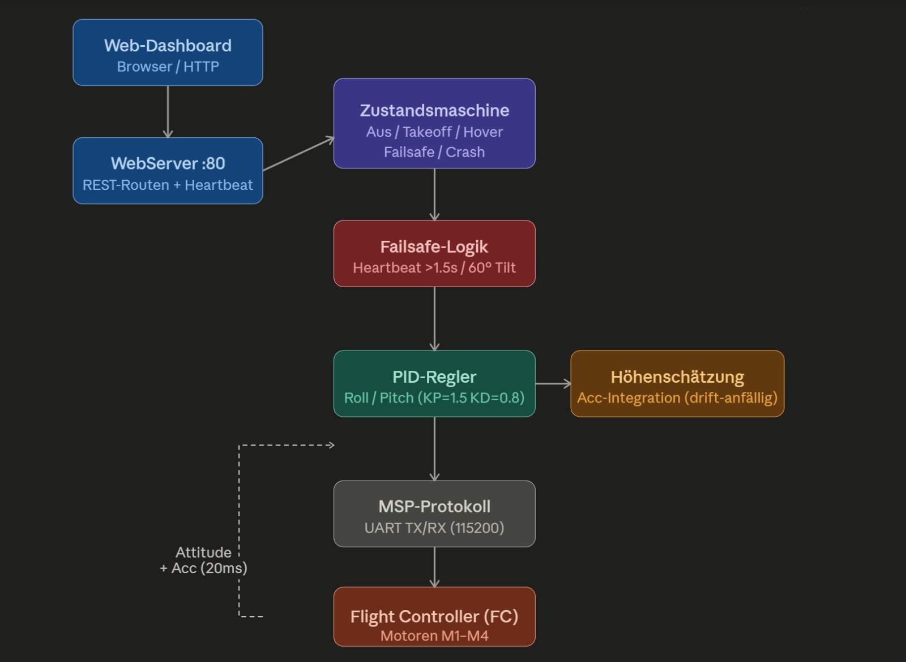

Neben der Companion-Firmware für die App gibt es eine zweite Firmware:
`PlatformIO/Projects/easypilot`. Sie bringt ihr eigenes Web-Dashboard mit und braucht weder
App noch Relay. Gedacht ist sie für Tests am Tisch, mit gefesselter Drohne. Es ist immer nur eine
der beiden Firmwares geflasht.

## Ablauf

1. Browser öffnet `http://<esp32>/`. Die Seite schickt alle 500 ms einen `/heartbeat`.
2. Start zeitbasiert (`/start_time`) oder über den Beschleunigungssensor (`/start_acc`, 18 cm).
   Liegt die Drohne schief (> 5°), antwortet die Firmware mit 400.
3. Eine Zustandsmaschine (Aus, Takeoff, Hover, Failsafe, Crash) steuert einen PID-Regler auf
   Roll/Pitch und gibt die Motorwerte per MSP an den Flight Controller.

## Sicherheit

- 1,5 s ohne Heartbeat → FAILSAFE, Motoren aus
- Roll oder Pitch über 60° → CRASH, Motoren aus
- Gas hart begrenzt auf 1400
- OTA-Updates mit Passwort, vor dem Flashen wird der Flugzustand zurückgesetzt

Die Höhenschätzung integriert die Beschleunigung und driftet deshalb. Für Schweben über längere
Zeit reicht sie nicht. Das war ein Grund, Positionshalten später mit echter Positionsmessung (in
Liftoff) anzugehen.
