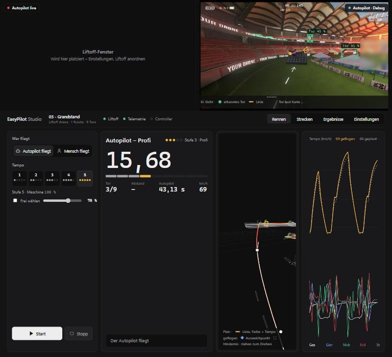
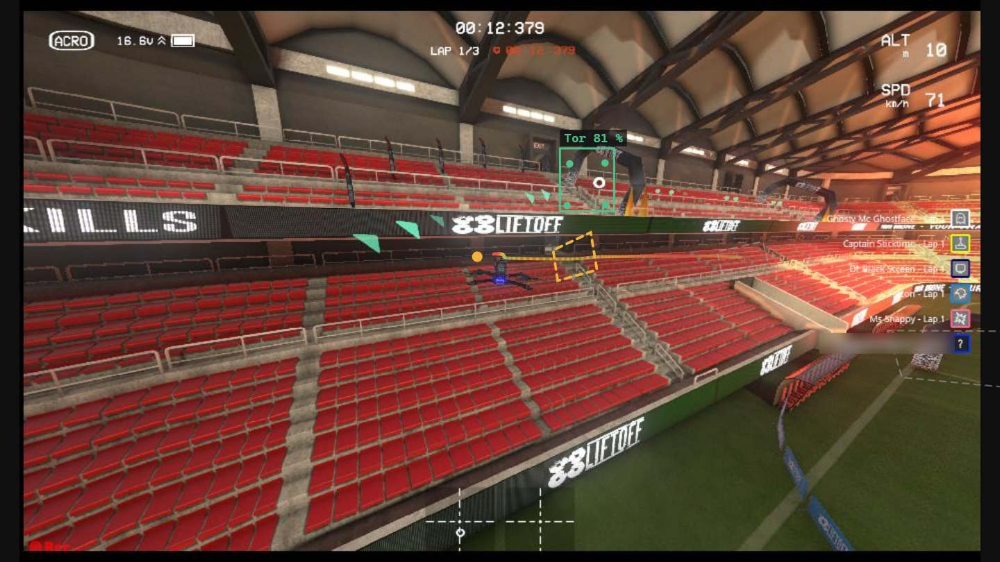

Eine Oberfläche für Vorführungen und den Tag der offenen Tür: Strecke wählen, Tempo einstellen,
Autopilot fliegen lassen oder eine Person gegen den Autopiloten antreten lassen – im Splitscreen.
Voraussetzung: [Autonomes Rennen einrichten](../autonomes-rennen-einrichten).

## Starten

```bash
cd simulator
python -m autopilot.studio            # öffnet die Oberfläche im Browser-App-Fenster
```

Liftoff muss laufen (Hauptmenü genügt). Beim ersten Laden einer Strecke startet das Studio
Liftoff mit diesem Rennen neu (ca. 1 Minute).

## Bildschirm

```
┌──────────────────────────┬──────────────────────────┐
│  Liftoff (live)          │  Autopilot               │
│  Mensch oder Autopilot   │  Video der Bestzeit ab GO│
├──────────────────────────┴──────────────────────────┤
│ Start · Tempo │ Zeit · Abstand │ Karte │ Bestenliste │
└─────────────────────────────────────────────────────┘
```

Fliegt der Autopilot, zeigen rechte Hälfte, Kartenfeld und Bestenlisten-Feld stattdessen die
[Live-Debug-Ansicht](#live-debug-ansicht-was-der-autopilot-sieht-und-tut).

**Einstellungen → „Liftoff anordnen“** setzt das Liftoff-Fenster randlos in das obere linke Viertel
und hält es im Vordergrund; die Seite im Vollbild (F11) lässt genau diesen Bereich frei. Das
funktioniert auf 1080p- und 4K-Bildschirmen. Ist Liftoff auf einem zweiten Bildschirm, zeigt
„Live-Bild als Stream“ das Bild stattdessen in der Seite.

## Bedienen

| Reiter | Inhalt |
|---|---|
| **Rennen** | „Autopilot fliegt“ oder „Mensch vs. Autopilot“, Tempo als Stufe 1–5 oder frei 10–100 %, Start/Stopp, Live-Zeit, Abstand zum Autopiloten an jedem Tor, Karte mit Geist, Bestenliste |
| **Strecken** | alle offiziellen Liftoff-Rennen und eigene Rennen aus dem Liftoff-Editor; Balken zeigen, für welche Stufen es schon eine Autopilot-Zeit gibt |
| **Ergebnisse** | Bestenliste der Strecke, letzte Läufe (löschbar), Autopilot-Zeiten aller Strecken |
| **Einstellungen** | Fenster-Anordnung, Runden, Zeitlimit, Kamera-Korrektur (KI), Debug-Ansicht, Controller-Status |

**Mensch vs. Autopilot:** Der Controller wird durchgeleitet (Liftoff bleibt auf vJoy). Einmal pro
Controller kalibrieren: `python -m autopilot.pilot calibrate`. Über Parsec funktioniert ein Gamepad
am entfernten Rechner genauso. Ohne Controller geht „Autopilot fliegt“.

**Splitscreen:** Rechts läuft die beste aufgezeichnete Runde des Autopiloten auf derselben
Strecke und Stufe, gestartet mit demselben GO – beide fliegen „gleichzeitig“. Gibt es noch keine,
erst einmal „Autopilot fliegt“ in dieser Stufe starten. (Echt gleichzeitig mit zwei Drohnen ginge nur
mit zwei PCs im Liftoff-Multiplayer.) Auch bei „Autopilot fliegt“ läuft rechts die bisherige
Bestzeit derselben Stufe mit – so lässt sich der Splitscreen ganz ohne Controller vorführen, etwa
über Parsec.

Strecken, deren Inhalte auf dem PC fehlen (Liftoff meldet „Missing data“), merkt sich das Studio
nach dem ersten Ladeversuch und blendet sie in der Streckenliste aus
(`%LOCALAPPDATA%\EasyPilot\runs\unavailable_races.json`, Eintrag löschen zum erneuten Versuch).

## Live-Debug-Ansicht: was der Autopilot sieht und tut

Bei jedem Lauf von „Autopilot fliegt“ zeigt das Studio live, was im Algorithmus passiert –
gedacht zum Erklären bei Vorführungen. Ein- und ausschalten unter **Einstellungen →
„Debug-Ansicht beim Autopiloten“** (standardmäßig an, wird im Browser gemerkt). Läufe von
Menschen zeigen weiter den Splitscreen.



| Feld | Inhalt |
|---|---|
| **KI-Sicht** (rechte Hälfte) | Das Live-Bild aus Liftoff. Jedes Tor, das die KI erkennt (YOLOv8-Pose auf der Grafikkarte, ~15 Bilder/s), bekommt einen grünen Rahmen mit den vier erkannten Ecken und der Sicherheit („Tor 81 %“). Mit dem kalibrierten Kameramodell (125° FOV, 42° Uptilt) und der Lage aus der Telemetrie werden darüber gelegt: die geplante Rennlinie (Farbe = geplantes Tempo, grün langsam → rot schnell), das nächste Tor laut Karte (gestrichelt) und der Zielpunkt, auf den der Regler gerade steuert. |
| **Plan** (Kartenfeld) | 3D-Ansicht, die der Drohne folgt: Rennlinie mit Tempo-Farben, Toröffnungen, die bekannten Hindernisse als Drahtgitter-Quader, die Ausweichpunkte des elastischen Bands (blaue Rauten), der tatsächlich geflogene Weg (weiß) und der Zielpunkt. Ziehen dreht die Ansicht, Doppelklick setzt sie zurück. |
| **Telemetrie** (Bestenlisten-Feld) | Die letzten 10 Sekunden: geflogenes gegen geplantes Tempo, die vier Steuerknüppel (Gas, Gier, Nick, Roll), Abstand zur Linie in cm und Lagefehler. |



Technisch: `studio.py` liefert die Daten des laufenden Fluges in `/api/state` (`debug`: Pose,
Zielpunkt, Sticks, Erkennungen) und die geplante Linie einmal pro Linie über `/api/plan`
(Punkte alle 0,5 m, Tore, Hindernisse bis 3 m neben der Linie, Kameramodell). Gezeichnet wird
in `dashboard/techview.js`. Die Erkennung läuft in einem eigenen Thread nur während eines
Laufs; die Steuerung (100 Hz) wird davon nicht gebremst.

**Hinweise für die Vorführung:**

- Strecken mit echten Torrahmen wählen, z. B. *Liftoff Arena 03 – Grandstand* oder
  *Minus Two 02*. Auf Strecken, die nur unsichtbare Checkpoints haben (Autumn Fields 01,
  Bardwell's Yard 01), findet die KI nichts – Linie und Plan funktionieren dort trotzdem.
- Linie, Kartentor und Zielpunkt liegen nur in der **FPV-Kamera** (Ego-Sicht) genau auf dem Bild,
  weil das Kameramodell für sie kalibriert ist. In der Verfolgerkamera (Drohne von hinten
  sichtbar, wie in den Bildern oben) sind sie versetzt; die Torerkennung funktioniert in beiden.
- Während eines Laufs keine anderen Fenster anklicken, sonst verliert Liftoff den Fokus
  („Reset kommt nicht an“); dann einfach noch einmal starten.

## Eigene Strecken

Im Liftoff-Editor gebaute Rennen erscheinen automatisch im Reiter Strecken („eigene Strecke“).
Die Torgeometrie kommt aus den Liftoff-Objekten selbst (`python -m autopilot.gatedb extract`,
einmal nach jedem Liftoff-Update), deshalb funktionieren alle Tortypen ohne Nachmessen.

## Fernzugriff

Zum Herzeigen über WireGuard + Parsec: Parsec zeigt den ganzen Bildschirm, die Oberfläche wird
normal bedient. Alternativ ist die Seite im lokalen Netz unter `http://<pc>:8765/` erreichbar
(`--key <geheim>` schützt die Bedienung).

## Gestaltung

Die Oberfläche folgt einer Zeitnahme bei Nacht: ruhige graue Flächen, ein Bernstein-Akzent für
Auswahl, nächstes Tor und Pilot, die Farbe steckt in der Uhr (Tor-Segmente wie Sektoren, Abstand
grün oder rot) und in der Streckenkarte. Erkennungszeichen ist die Startampel: Der Countdown läuft
über Lichter, und die Tempostufe 1–5 zeigt sich als Zahl leuchtender Lichter. Bei niedrigen
Bildschirmhöhen (1280×720, kleines Parsec-Fenster) wird das Bedienfeld kompakter.

Der Design-Durchgang (16.11.2026) entstand mit [unslop](https://github.com/heydamir/unslop) von
Damir Sokolovsky (@heydamir), lizenziert unter CC BY 4.0.
