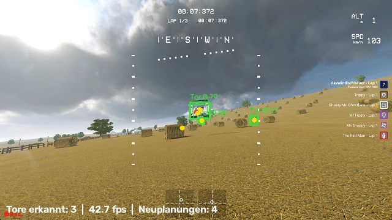

## Aufbau

| | |
|---|---|
| Simulator | Liftoff 1.7.6, Level „Straw Bale“, Armattan Mongoose, Acro |
| Programm | `simulator/autopilot`, Regler im Takt der Telemetrie (100 Hz) |
| Ausgabe | vJoy, kein physischer Controller |
| PC | Ryzen 7 7700X, RTX 5060 Ti, Liftoff im 1080p-Fenster, VSync aus |

Alle Flüge hat das Programm allein geflogen, inklusive Menüs, Reset und Rennstart.

## Zwischenstand vor dem Rennen

| Schritt | Ergebnis |
|---|---|
| Erster Schwebeflug mit neuem Regler | 3 m Höhe, Position gehalten; Gas schwankte (VSync = 30 fps) |
| VSync aus, Fenster 1080p | Telemetrie gleichmäßig 100 Hz, Eingabeverzögerung ~20 ms |
| Systemidentifikation | Schwebegas 0,281, Schub ~ Gas², Raten vermessen |
| Kamerakalibrierung | FOV 125°, Uptilt 42°, 0,8 px Restfehler |
| Torposen aus der XML ins Kamerabild projiziert | liegen auf den echten Torbögen |

## Field Day, eine Runde ab Start (Free Flight, eigene Torwertung)

| Tempo | Zeit | Tore | max. Abweichung | Bemerkung |
|---|---|---|---|---|
| 35 % | 39,7 s | 17/17 | 0,30 m | |
| 60 % | 26,2 s | 17/17 | 0,55 m | |
| 70 % | 24,1 s | 17/17 | 1,03 m | Drohne sackt bei Tempo 0,9 m unter die Linie |
| 80 % (vor Fix) | – | 8/17 | Absturz | Luftwiderstand nicht modelliert |
| 80 % (mit Widerstandsmodell) | 24,0 s | 17/17 | 0,49 m | |
| 100 % | **18,7 s** | 17/17 | 1,03 m | Spitze 35 m/s (126 km/h) |

**Fix:** Luftwiderstand (0,033 1/m) im Regler vorgesteuert und in der Geschwindigkeitsplanung
berücksichtigt, Grenze der Störgrößenschätzung von 25 auf 45 m/s² erhöht.

## Field Day, Race-Modus, von Liftoff gewertet

3 Runden bei 80 %: **59,154 s, Platz 1** (Runden 19,58 / 19,63 / 19,63 s).
Liftoff-Bots: Captain Sticktime 1:33,725, Ms Snappy 1:36,380.

## After Hours (zweite Strecke, andere Tortypen) – 19.10.2026

Strecke mit Torbögen, zwei MultiGP-Rahmen-Varianten auf Masten und unsichtbaren Checkpoint-Boxen;
Start- und Zieltor sind dasselbe Tor.

| Versuch | Ergebnis | Ursache / Fix |
|---|---|---|
| 60 %, erste Höhenannahme | Liftoff wertet keine Runde | MultiGP-Rahmen hängen auf Masten, Drohne flog unten durch |
| nach Messung (Frame01 4,05 m, Frame02 6,45 m), 60 % | **1:25,684, Platz 1** (28,27 / 28,71 / 28,71 s) | – |
| 80 % | Liftoff wertet nur 2 Runden | Start zu steil: über das Starttor geflogen. Fix: Startlinie gerade und auf Torhöhe, Tempo bis zum ersten Tor begrenzt |
| 80 % | Absturz nach 22 Toren | Nach dem 6,5-m-Rahmen verlangte die Linie mehr Abwärtsbeschleunigung als g; Drohne blieb am nächsten Torbogen hängen. Fix: Abwärtskrümmung auf 0,6 g begrenzt, Absturzerkennung |
| 80 % | **1:17,035, Platz 1** (26,09 / 25,48 / 25,47 s), bester Bot 1:22,5 | eigene Torzählung 70/70 = Liftoff |

Außerdem behoben: Ein gemeinsames Start-/Zieltor wird pro Rundenwechsel nur einmal gezählt
(vorher erwartete die eigene Wertung zwei Durchflüge).

## KI-Torerkennung

| | |
|---|---|
| Daten | 8882 Bilder aus 9 Runden auf 2 Strecken, 21 820 Tore automatisch beschriftet |
| Modell | YOLOv8n-Pose, 4 Eckpunkte, 640 px; erst 60 Epochen, dann 25 Epochen nachtrainiert |
| Ergebnis (Validierung, 2589 Bilder, beide Strecken) | Box-mAP50 0,77, Eckpunkt-mAP50 0,82, Präzision 0,88, Recall 0,69 |
| Geschwindigkeit | 1,4 ms Inferenz pro Bild; im Rennen 40–46 Bilder/s inklusive Aufnahme und Overlay |

Der Recall ist niedrig, weil auch sehr weit entfernte, winzige Tore beschriftet sind.

## Kamera korrigiert die Karte (19.10.2026)

**Test:** Der MultiGP-Rahmen CP77 auf „After Hours“ wird in der Karte absichtlich 1,61 m zur Seite
verschoben (`--perturb`). Die Öffnung ist 2,6 m breit: Ohne Korrektur fliegt die Drohne vorbei.
Bewertet wird mit `verify.py` gegen die **echten** Torpositionen und mit Liftoffs eigener Wertung.

| Versuch | Kartenfehler danach | Echte Tore | Liftoff | Erkenntnis / Fix |
|---|---|---|---|---|
| 60 %, erste Version | 0,31 m | 46/70, Absturz | – | 21 richtige Tore „mitkorrigiert“ (Rauschen), 119 Neuplanungen. Fix: Median über ≥ 8 Messungen, Streuungsprüfung, Totzone, Starttor fest |
| 60 % | 0,19 m | 69/70 | 2 von 3 Runden | Korrektur kam in Runde 1 zu spät. Fix: Neuplanung nach 0,15 s statt 0,5 s |
| 60 %, lockerere Schwellen | 0,44 m | 11/70, Absturz | – | Zwei richtige Tore falsch korrigiert → Schwellen wieder streng |
| 60 % | 0,30 m | 69/70 | – | Hintereinander stehende gleiche Tore verwechselt (CP127 statt CP77). Fix: Zuordnung über PnP-Tiefe in 3D statt Nähe im Bild |
| 60 % | 0,35 m | **70/70** | **3 Runden, 1:28,099** | ✓ |
| 80 % ohne Verschiebung | – | 32/70, Absturz | – | Falsche Korrekturen entlang der Flugrichtung (Bild-zu-Telemetrie-Verzögerung: 30 ms × 27 m/s ≈ 0,8 m). Fix: nur Versatz in der Torebene übernehmen |
| 80 % ohne Verschiebung | – | **70/70** | **1:17,558, Platz 1** | ✓ Kamera verschlechtert nichts |
| 80 %, Verschiebung | 0,16 m | 13/70, Absturz | – | Späte Korrektur 3–8 m vor einem Torbogen → seitlicher Sprung. Fix: Linie ab 12 m vor dem Tor eingefroren |
| 80 %, Verschiebung | 0,16 m | 13/70, Absturz | – | Torbögen sind oben rund, die „Ecken“ nur gedacht → 0,5 m Scheinfehler. Fix: Totzone 0,6 m |
| **80 %, Verschiebung** | **0,10 m** | **70/70** | **1:17,213, Platz 1** | ✓ nur CP77 korrigiert |

## Alle offiziellen Strecken, Stufe 3 (Testreihen 7–9, 16.11.2026)

Jede Testreihe fliegt alle offiziellen Liftoff-Rennen einmal automatisch (`python -m autopilot.matrix
--stages 3 --again`, ca. 2,5 h). Bestanden heißt: **Liftoff selbst** hat die Runde oder – bei
Punkt-zu-Punkt-Rennen – die Rennzeit gewertet.

| Testreihe | Bestanden | Wichtigste Änderungen davor |
|---|---|---|
| 7 | 24/92 | Ausgangsstand |
| 8 | 44/91 | Reset nach dem Laden (Drohne blieb sonst am Start stehen), Lage halten bei Gas 0, sanfter Start, Checkpoint-Volumen korrigiert (Ziel galt 12 m zu früh als erreicht) |
| 9 | **53/90** | Airmode-Budget (Drohne hing beim Sinkflug 1 m über der Linie), Treffer-Erkennung, geglättete Vorsteuerung; Punkt-zu-Punkt-Zeiten aus `raceTimes.xml` |

Zwei Rennen (PineValley 05, ShortCircuit 03) starten auf diesem PC nicht: Liftoff meldet
„Missing data“ (Inhalt nicht installiert). Sie werden gemerkt und im Studio ausgeblendet.

**Absturzursachen in Testreihe 8** (aus den Flugprotokollen klassifiziert):

| Ursache | Anteil | Lösung |
|---|---|---|
| Sinkflug mit Gas ~0: jede Drehung macht im Airmode Schub (bis 13 m/s²), Drohne steigt statt zu sinken, trifft Rahmen/Schienen | größte Gruppe | Stickausschlag auf den gewünschten Schub begrenzt |
| Soll-Lage kippt beim Wechsel Beschleunigen → Bremsen um 90° auf einmal | häufig | Vorsteuerung über ±60 ms gemittelt |
| Nach einem Streifer laufen die Schätzwerte an ihre Grenzen, Drohne fliegt mit Vollgas seitwärts | einzeln | Aufprall (> 95 m/s² in 20 ms) setzt die Schätzung zurück |
| Linie selbst berührt ein bekanntes Objekt (46 von 92 geplanten Linien!) | viele | elastisches Band statt Einzel-Hilfspunkte, siehe unten |
| Objekt fehlt in der Level-Geometrie (MarinaBay 01, Hall26 01) | einzeln | offen |

**Ausweichen – drei Strategien im Vergleich** (alle 92 Strecken, eigener Simulator mit 30 ms
Telemetrie-Verzögerung, Stufe 3):

| | Linien mit Kontakt | Kontaktpunkte | saubere Flüge | Planungszeit |
|---|---|---|---|---|
| bisher (Hilfspunkte) | 46 | 356 | 49 | 1× |
| iterative Hilfspunkte | 32 | 174 | 63 | 0,44× |
| Korridorsuche | 31 | 169 | 64 | 0,34× |
| **elastisches Band** | **28** | **156** | **68** | **0,36×** |

Das Band gewinnt 19 Strecken und verliert keine; auch Stufe 1 (53 → 74) und Stufe 5 (27 → 39)
profitieren. Die Linien haben weniger Hilfspunkte (1607 → 1174) und weniger Krümmung. Die
verbleibenden Kontakte liegen größtenteils in Toröffnungen selbst (z. B. Lichttore, deren
Kollisionsquader die ganze Öffnung umschließt) oder am Startplatz.

**Studio Ende-zu-Ende (16.11.):** Strecke über die Oberfläche geladen, Autopilot Stufe 3 auf
BardwellsYard 01 dreimal im Ziel (42,4–42,6 s), Splitscreen mit synchron laufender Bestzeit.
Dabei gefunden und behoben: ein Syntaxfehler in `studio.js` legte die gesamte Oberfläche lahm;
der Reset kam nach einem Klick im Browser nicht bei Liftoff an (braucht echte Fensteraktivierung).

## Nächste Schritte

- Weitere Strecken und Tortypen (aufblasbare Bögen, Checkpoint-Boxen allein).
- 10 Runden am Stück bei 100 % (M9) und Vergleich mit der Bestzeit des Teams.
- GPS-Zielflug in Liftoff testen (bisher nur im eigenen Modell).
- Rennmodus für den Tag der offenen Tür (Bestenliste, Ablauf Mensch → Programm).
