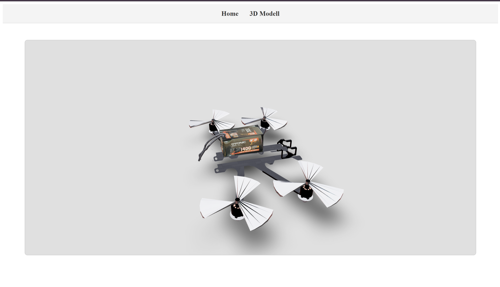



Zeitraum: 08.12. – 21.12.2025 · Review am 22.12.2025 · Teilnehmer: Simon Eder, David Windischbauer

## Ziel des Sprints

*Als Drohnenpilot möchte ich den Live-Zustand der Drohne mit den Live-Telemetriedaten in einem
3D-Modell auf einem Dashboard sehen können, um eine Grundlage für spätere Simulationen zu haben.*

## Umgesetzt

| Aufgabe | Status |
|---|---|
| MAVLink-Anbindung | erledigt |
| Live-Telemetrie über WebSockets | erledigt |
| 3D-Modell rendern (React Three Fiber) | erledigt |
| Renderer beschleunigen | erledigt |

## Nicht umgesetzt

Export der Telemetriedaten (aus der Definition of Done) wurde nicht umgesetzt.

## Demo

## Verknüpft

- Sprintplanung: [MoM 2025-11-25](../../mom/2025-11-25)
- Pull Requests: #7, #9, #15, #16, #17, #20
